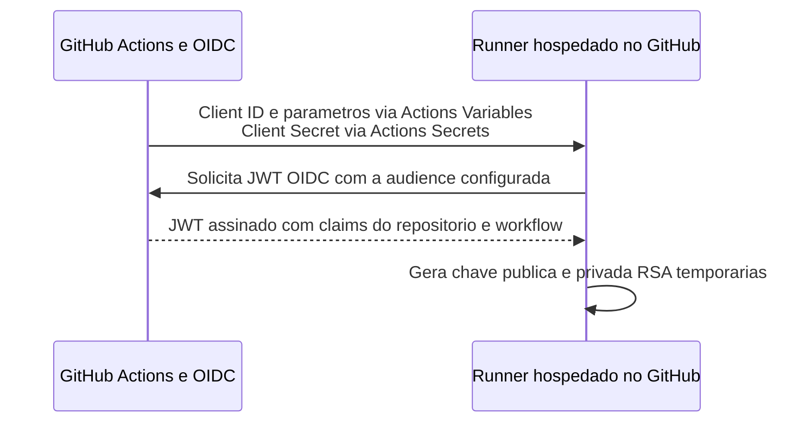
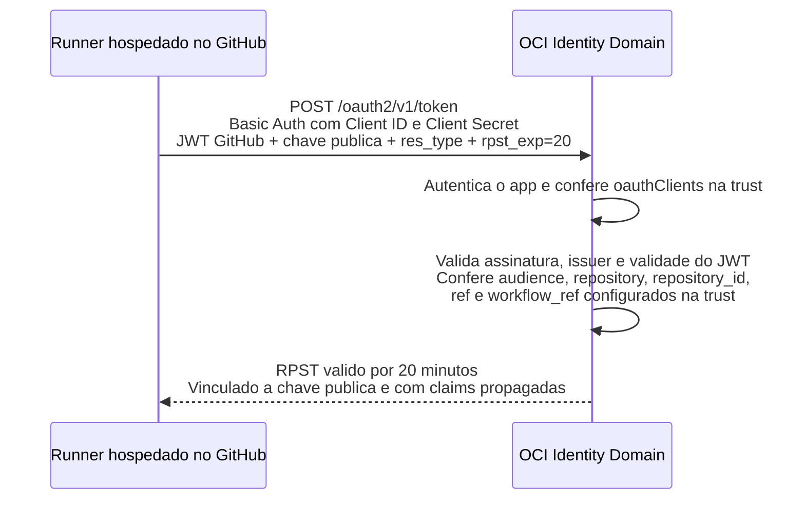
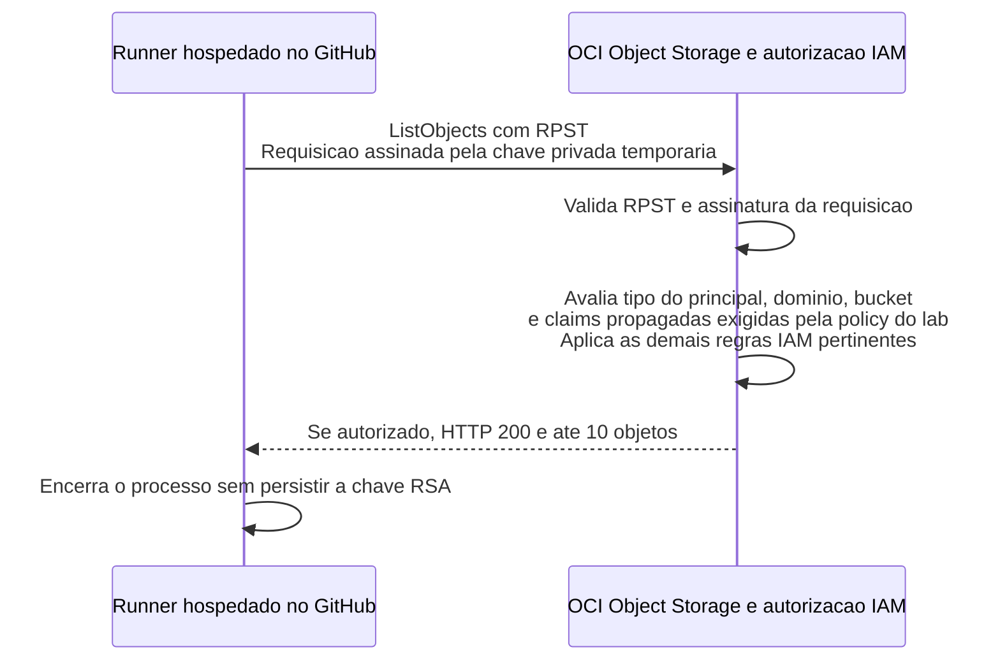

# Laboratório de integração entre GitHub Actions e OCI

Use este laboratório para entender e configurar a autenticação de um GitHub Actions workflow no OCI com OIDC e Resource Principal Session Token (RPST).

O workflow roda no GitHub, recebe um token temporário OCI e testa a listagem de objetos de um bucket privado. O fluxo utiliza um aplicativo OAuth com `client_id` e `client_secret`, armazenado como GitHub Actions Secret. Não exige uma chave de API de usuário OCI no workflow.

## Como funciona a autenticação

O fluxo abaixo acontece a cada execução, depois que o app OAuth, a trust e a policy foram configurados. Ele está dividido em três etapas e mostra o caminho de sucesso.

### 1. Obter o token GitHub e gerar a chave temporária

O GitHub disponibiliza os parâmetros e o segredo ao job. Com a permissão `id-token: write`, o runner solicita um JWT OIDC para a audience configurada e gera um par RSA em memória.



### 2. Autenticar o aplicativo e trocar o JWT por RPST

O JWT identifica o workload GitHub. O Client ID e o Client Secret autenticam o aplicativo autorizado a solicitar a troca. O Identity Domain verifica os dois, aplica as regras da trust e emite um RPST vinculado à chave pública.



### 3. Assinar a chamada OCI e autorizar o acesso ao bucket

O SDK usa o RPST e a chave privada temporária para assinar a chamada `ListObjects`. A autorização considera a policy do laboratório e as demais regras IAM aplicáveis. O diagrama representa essa avaliação lógica; não exige um serviço IAM separado no laboratório.



O JWT GitHub, o RPST e a chave RSA são temporários; o RPST expira ao fim de sua validade. **O Client Secret do app OAuth é persistente** e permanece em Actions Secrets até ser removido ou substituído. O Client ID é um identificador e fica em Actions Variables. A sessão administrativa do OCI CLI é usada somente na configuração e na limpeza locais; não participa da execução do workflow. [Documentação oficial do fluxo JWT → RPST](https://docs.oracle.com/en-us/iaas/Content/Identity/api-getstarted/token_exchange_grant_type_workload_id-federation.htm)

## Começar

Execute no Bash, em Linux ou no WSL. Clone este repositório público e copie somente o conteúdo da pasta `lab/` para um diretório novo:

```bash
git clone https://github.com/wuilber002/oci-github-actions-oidc-rpst.git oci-wif-examples
mkdir oci-wif-lab
cp -a oci-wif-examples/lab/. oci-wif-lab/
cd oci-wif-lab
```

O diretório `oci-wif-lab/` será a raiz do seu próprio repositório. A cópia não inclui o histórico Git do repositório de exemplos.

**Siga o [procedimento completo em lab/README.md](lab/README.md).** Ele cobre os pré-requisitos, a criação de um repositório próprio ou o uso de um existente, a configuração dos dois lados pelo CLI, o teste e a limpeza do ambiente OCI e GitHub. Depois da cópia, o mesmo procedimento estará em `oci-wif-lab/README.md`.

## O que está na pasta lab

```text
lab/
├── README.md
├── .gitignore
├── .gitattributes
├── .github/workflows/oci-wif-integration.yml
├── config/
│   ├── lab.env.example
│   ├── app.json
│   └── trust.json
├── requirements.txt
└── scripts/
    ├── configure.sh
    ├── cleanup.sh
    ├── copy-to-repo.sh
    ├── render.jq
    └── validate_oci.py
```

Todos os parâmetros distribuídos são exemplos. Preencha os dados do seu ambiente apenas no arquivo local `config/lab.env`, ignorado pelo Git. Arquivos gerados e estado de execução também ficam fora do versionamento.

O laboratório usa um compartment e um bucket já existentes. Cria um aplicativo OAuth sem papel administrativo, uma trust restrita ao repositório e uma policy que permite apenas listar objetos do bucket escolhido.

## Referências

- [Fluxo JWT para RPST no OCI](https://docs.oracle.com/en-us/iaas/Content/Identity/api-getstarted/token_exchange_grant_type_workload_id-federation.htm)
- [OIDC no GitHub Actions](https://docs.github.com/en/actions/reference/security/oidc)
